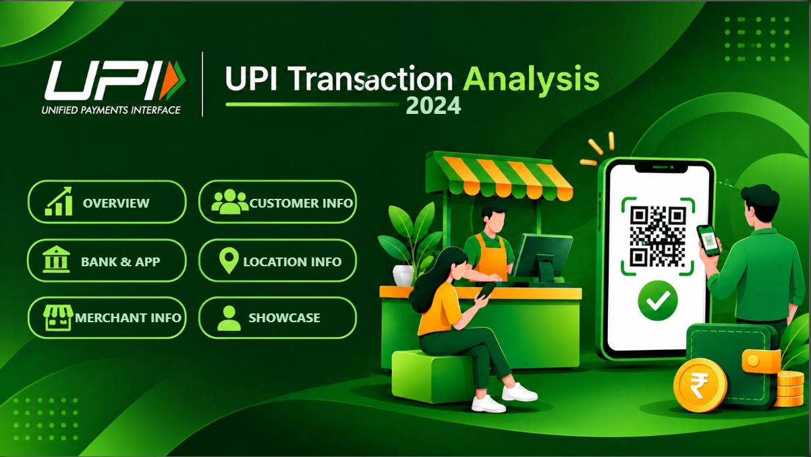
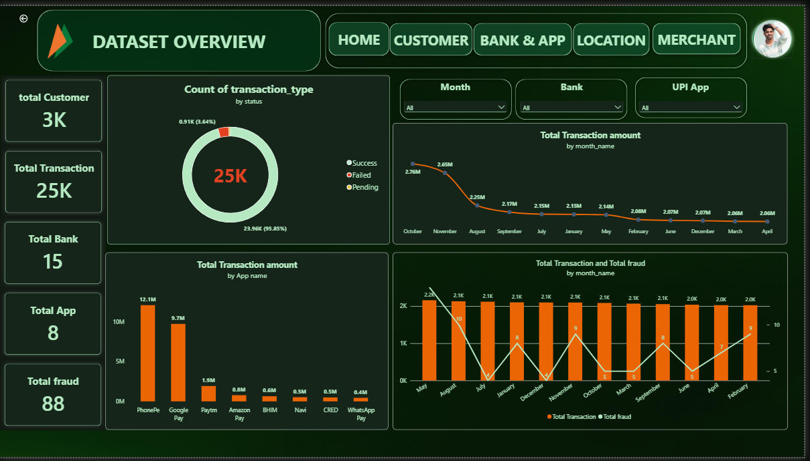
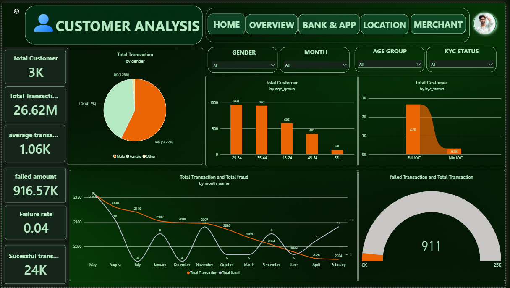
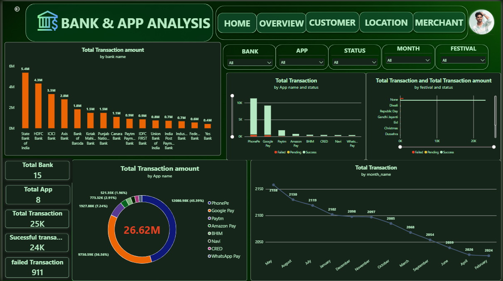
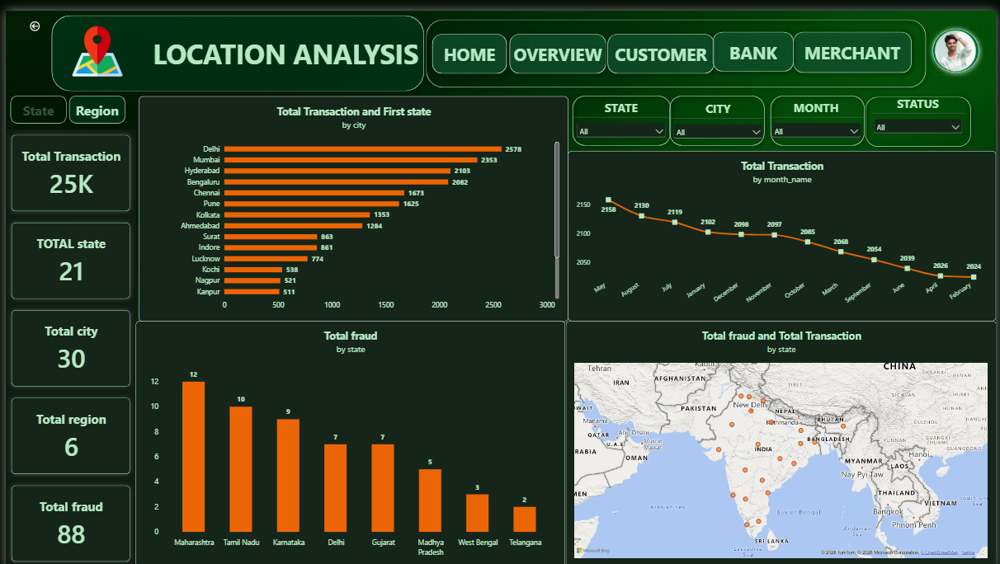
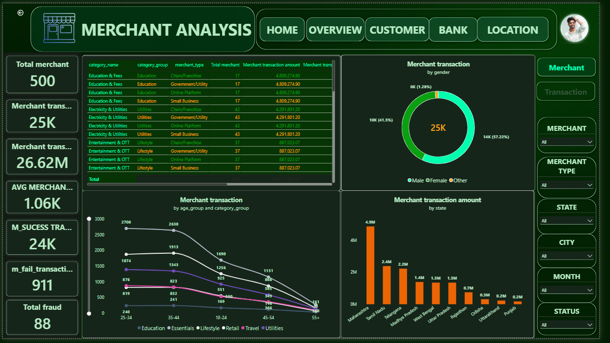
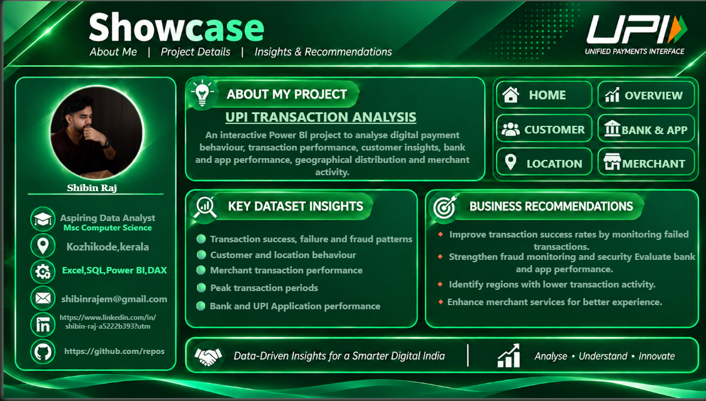

# 📊 UPI Transaction 2024 Analytics Dashboard

## 📌 Project Overview

This project presents an interactive **UPI Transaction Analytics Dashboard** built using Power BI to analyze UPI transactions, customer behavior, bank and application performance, geographical distribution, and merchant activities. It contains seven report pages that provide meaningful business insights through KPIs, charts, tables, maps, and interactive filters.

## 🎯 Project Objectives

- Analyze total transactions, transaction amount, and transaction status.
- Monitor successful, failed, and fraudulent transactions.
- Understand customer demographics and transaction behavior.
- Compare transaction performance across banks and UPI applications.
- Analyze geographical transaction distribution across states, cities, and regions.
- Evaluate merchant transaction performance and category-wise activities.
- Identify monthly transaction trends and patterns.

## 🛠️ Tools & Technologies

- Power BI – Dashboard development and visualization
- Power Query – Data cleaning and transformation
- DAX – Measures and KPI calculations
- Data Visualization – Charts, tables, maps, slicers, and KPI cards

## 📈 Dashboard Pages

### 1. Welcome Page

Provides an introduction and landing page for the UPI Transaction Analytics Dashboard.

### 2. Overview Dashboard

Provides an overall summary of UPI transaction performance, including total transactions, transaction amount, customers, banks, applications, fraud analysis, transaction status, and monthly transaction trends.

### 3. Customer Dashboard

Analyzes customer demographics and transaction behavior through gender distribution, age groups, KYC status, successful and failed transactions, failure rate, monthly trends, and fraud analysis.

### 4. Bank & App Dashboard

Compares bank and UPI application performance using bank-wise transactions, app-wise transaction distribution, successful and failed transactions, festival-wise analysis, and monthly transaction trends.

### 5. Location Dashboard

Explores geographical transaction performance across states, cities, and regions using maps, location-based comparisons, fraud distribution, and regional transaction analysis.

### 6. Merchant Dashboard

Analyzes merchant performance through total merchants, transaction amounts, average merchant amount, successful and failed transactions, merchant categories, monthly trends, and fraud analysis.

### 7. Showcase Page

Provides a dedicated showcase page for presenting the dashboard project.

## 💡 Key Analysis Areas

- Total transaction and transaction amount analysis.
- Successful and failed transaction comparison.
- Customer demographic and KYC analysis.
- Bank-wise and application-wise transaction performance.
- State-wise and city-wise transaction distribution.
- Fraud transaction analysis.
- Merchant category and performance analysis.
- Monthly transaction trend analysis.

## 🚀 Skills Demonstrated

- Data cleaning and transformation
- Data modeling and DAX calculations
- KPI development
- Customer behavior analysis
- Bank and payment application analysis
- Geographic data visualization
- Interactive dashboard design
- Business analysis and insight generation
- Data storytelling and visualization

## 📷 Dashboard Screenshots

### Welcome Page



### Overview Dashboard



### Customer Dashboard



### Bank & App Dashboard



### Location Dashboard



### Merchant Dashboard



### Showcase Page



## 📂 Project Structure

```text
UPI-Transaction-Analytics/
│
├── screenshots/
│   ├── 01-welcome.png
│   ├── 02-overview.png
│   ├── 03-customer.png
│   ├── 04-bank-app.png
│   ├── 05-location.png
│   ├── 06-merchant.png
│   └── 07-showcase.png
│
├── upi_project_new.pbix
│
└── README.md
```


